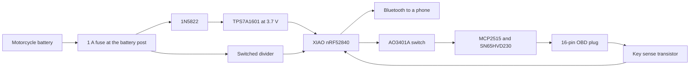

# Bike link wiring

Pin tables and the power path for [bike-link-build.md](bike-link-build.md). Read that file for why each part is here, the sleep budget, and the radio limit. This file is the soldering picture.

The first build has no radio. Leave the radio header empty.

## Block diagram



The P6KE18A is across the regulator input, not in series. One end on the diode cathode, the other on ground.

```text
Battery +  -- 1A fuse --+-- 1N5822 --> TPS7A1601 IN --> 3.7 V --> XIAO BAT+
                         |                  |
                         |                  +-- P6KE18A to ground
                         |
                         +-- 2N3906 --> 100k / 12k divider --> XIAO D0

Battery -  ---------------------------------------------- XIAO GND
                                                            and CAN ground
                                                            and OBD pin 4 or 5

Key-switched 12 V -- 100k -- 2N3904 -- XIAO D2     (key on pulls D2 low)
OBD pin 6 CAN H ---------------------- SN65HVD230 CANH
OBD pin 14 CAN L --------------------- SN65HVD230 CANL

XIAO 3V3 -- AO3401A -- MCP2515 VDD and SN65HVD230 VCC
```

The diode's band points toward the regulator. The TVS band points toward the fused 12 V, the other end to ground. A backwards TVS conducts all the time and blows the fuse.

## XIAO nRF52840, SKU 102010448

Power the back battery pads: regulator 3.7 V to BAT+, regulator ground to the pad ground. USB is for programming on the bench. Unplug USB before the sleep test and before the box goes on the bike.

The 5 V pin is USB power. The 3V3 pin is an output. Do not feed 12 V into either pin, and do not feed the regulator into 3V3.

Leave the on-board battery-read enable (P0.14) alone. Seeed warns that driving it the wrong way can overvoltage their own battery-sense pin. This build uses D0 for voltage.

| XIAO pin | Connects to                      | Idle state                                                                |
| -------- | -------------------------------- | ------------------------------------------------------------------------- |
| BAT+     | TPS7A1601 output, about 3.7 V    | Always powered                                                            |
| GND      | Box ground                       |                                                                           |
| 3V3      | Source of the AO3401A            | Output, on whenever the board is powered                                  |
| D0       | Divider output, the ADC          | Input                                                                     |
| D1       | 2N3904 that turns the divider on | Low while parked. High only for the sample.                               |
| D2       | Ignition transistor collector    | Internal pull-up. Low means key on.                                       |
| D3       | AO3401A gate                     | High or pulled up while parked, so CAN power stays off. Low turns CAN on. |
| D4       | MCP2515 pin 16, CS               | High while idle. The chip select is active low.                           |
| D6       | Radio TX later                   | Leave open on the first build                                             |
| D7       | Radio RX later                   | Leave open on the first build                                             |
| D8       | MCP2515 pin 13, SCK              | SPI clock                                                                 |
| D9       | MCP2515 pin 15, SO               | SPI data from the CAN controller                                          |
| D10      | MCP2515 pin 14, SI               | SPI data to the CAN controller                                            |

D5, the NFC pins, and the user LED pins are unused.

## Regulator, TPS7A1601

HVSSOP-8. The metal pad on the bottom goes to ground. EN (pin 5) ties to IN (pin 8). PG (pin 3) and DELAY (pin 7) stay open. NC (pin 6) stays open.

| Pin | Name | Connection                                   |
| --- | ---- | -------------------------------------------- |
| 1   | OUT  | XIAO BAT+, and the top of R1                 |
| 2   | FB   | R1 and R2 join here                          |
| 4   | GND  | Box ground. Solder the thermal pad here too. |
| 5   | EN   | Tied to pin 8                                |
| 8   | IN   | Cathode of the 1N5822, and the P6KE18A       |

R1, 210 kΩ 1%, from OUT to FB. R2, 100 kΩ 1%, from FB to ground. The datasheet formula is VOUT = 1.193 × (1 + R1 / R2), which is about 3.70 V with these two resistors. The divider draws about 12 µA. Wash the flux off so the high-value resistors do not drift.

10 µF ceramic from IN to ground, and 10 µF ceramic from OUT to ground, close to the chip.

Check the output with a meter before you connect the XIAO. Expect about 3.7 V. If you had to use 200 kΩ for R1, expect about 3.58 V. Either is acceptable. 12 V on this output means a solder bridge. Do not connect the XIAO until the meter is right.

## Voltage divider

The sense point is the fuse output, on the battery side of the Schottky, so the diode drop is not in the reading.

```text
Fused battery + ---- emitter of 2N3906
                      collector of 2N3906 ---- 100 kΩ 1% ----+---- XIAO D0
                                                             |
                                                          12 kΩ 1%
                                                             |
                                                           ground

2N3906 base -- 100 kΩ -- emitter
2N3906 base -- 10 kΩ -- collector of 2N3904
2N3904 emitter -- ground
2N3904 base -- 47 kΩ -- XIAO D1
2N3904 base -- 100 kΩ -- ground
```

TO-92 pin order for a 2N3904 or 2N3906, flat face toward you, pins down: emitter, base, collector.

D1 high turns the divider on. D1 low leaves it off. At 12.6 V on the battery the ADC pin should see about 1.35 V. The firmware multiplies by 112 / 12. Compare with a meter and trim until the JSON matches within 0.1 V.

A 3.3 V zener sits on D0, band toward D0, other end to ground. It should be off during a normal 8–16 V reading. It is there for a spike while the divider is switched on.

## Ignition sense

```text
Key-switched 12 V -- 100 kΩ -- base of 2N3904
                     base -- 100 kΩ -- ground
                     collector -- XIAO D2
                     emitter -- ground
```

Turn on the XIAO internal pull-up on D2. Key on, D2 reads low. Key off, D2 reads high. Current from the sense wire is about 0.1 mA, and only while the key is on.

The sense wire is OBD pin 16 only when that pin is about 0 V with the key off and about battery voltage with the key on. If pin 16 stays hot with the key off, leave it open and land this same 100 kΩ on a wire that does follow the key, such as the tail lamp.

## CAN section

Power for both chips comes from the XIAO 3V3 pin through the AO3401A. Source of the MOSFET to XIAO 3V3. Drain to the CAN supply rail. Gate to XIAO 3V3 through 100 kΩ, so the rail stays off if D3 floats. D3 low turns the rail on. D3 high keeps it off.

100 nF ceramic across each chip, from its supply pin to ground.

### MCP2515-I/P, DIP-18

Pins from the Microchip datasheet (PDIP).

| Pin | Name   | Connection                                    |
| --- | ------ | --------------------------------------------- |
| 1   | TXCAN  | SN65HVD230 pin 1 (D)                          |
| 2   | RXCAN  | SN65HVD230 pin 4 (R)                          |
| 3   | CLKOUT | Open                                          |
| 4   | TX0RTS | Open. Internal pull-up.                       |
| 5   | TX1RTS | Open. Internal pull-up.                       |
| 6   | TX2RTS | Open. Internal pull-up.                       |
| 7   | OSC2   | Crystal                                       |
| 8   | OSC1   | Crystal                                       |
| 9   | VSS    | Ground                                        |
| 10  | RX1BF  | Open                                          |
| 11  | RX0BF  | Open                                          |
| 12  | INT    | Open. The firmware polls while the key is on. |
| 13  | SCK    | XIAO D8                                       |
| 14  | SI     | XIAO D10                                      |
| 15  | SO     | XIAO D9                                       |
| 16  | CS     | XIAO D4. Active low.                          |
| 17  | RESET  | 10 kΩ to the switched 3.3 V rail. Active low. |
| 18  | VDD    | Switched 3.3 V                                |

16 MHz crystal between pins 7 and 8. Use the two load capacitors the crystal datasheet asks for. A crystal marked for 18 pF load usually wants about 22 pF on each leg, to ground. A wrong crystal frequency makes the bike fail to answer. It does not, by itself, drive the CAN wires.

### SN65HVD230

SOIC-8. Pins from the TI datasheet.

| Pin | Name | Connection                                                                                                                         |
| --- | ---- | ---------------------------------------------------------------------------------------------------------------------------------- |
| 1   | D    | MCP2515 TXCAN                                                                                                                      |
| 2   | GND  | Box ground                                                                                                                         |
| 3   | VCC  | Switched 3.3 V                                                                                                                     |
| 4   | R    | MCP2515 RXCAN                                                                                                                      |
| 5   | Vref | Open                                                                                                                               |
| 6   | CANL | OBD pin 14, through the twisted pair                                                                                               |
| 7   | CANH | OBD pin 6, through the twisted pair                                                                                                |
| 8   | RS   | Ground. High-speed while the chip is powered. Parked state is "power removed," because standby on this part is still about 370 µA. |

No 120 Ω resistor between CANH and CANL. The bike is already terminated. If a carrier board has a terminator jumper, leave it open and measure that it is open.

## 16-pin OBD plug

Male SAE J1962 plug, the regular car-style OBD-II pigtail. This plugs into the Triumph's female socket, usually under the seat. The pigtail wires are the signal wires. The 18 AWG battery leads do not go through this plug.

Looking into the bike's socket, wide edge up: top row pins 1–8 left to right, bottom row pins 9–16 left to right.

| Pin             | Wire                                                     | Other end                                |
| --------------- | -------------------------------------------------------- | ---------------------------------------- |
| 4 or 5          | ground, whichever pin has continuity to battery negative | Box ground                               |
| 6               | CAN H, one side of the twisted pair                      | SN65HVD230 pin 7                         |
| 14              | CAN L, the other side of the pair                        | SN65HVD230 pin 6                         |
| 16              | sense, only if it follows the key                        | 100 kΩ into the ignition transistor      |
| every other pin | none                                                     | Cut the pigtail wire off and insulate it |

Before you trust a ready-made pigtail, battery negative disconnected:

- Buzz each pigtail wire to its pin. Do not trust the colors printed on the jacket.
- Pin 4 or pin 5 has continuity to battery negative. Use the one that does. If neither does, leave both open. The battery negative wire is the ground.
- Pin 16 is 0 V with the key off and about battery voltage with the key on. If that is not true, do not use pin 16 for sense.
- Pins 6 and 14 are not shorted to ground or to battery positive.
- With the bike off and this cable unplugged, resistance between the bike's pins 6 and 14 is often about 60 Ω. Plugging in the sleeping box should not change it.

## Mailbox, later

```text
USB 5 V adapter --> ESP32-S3-DevKitC-1
Devkit 3V3 ------ RYLR998 VDD
Devkit GND ------ RYLR998 GND
Devkit UART TX -- RYLR998 RX
Devkit UART RX -- RYLR998 TX
```

The bike side of the same radio, when you add it:

```text
XIAO 3V3 -- RYLR998 VDD
XIAO GND -- RYLR998 GND
XIAO D6  -- RYLR998 RX
XIAO D7  -- RYLR998 TX
```

The radio's supply maximum is 3.6 V. Use 3.3 V. Set `AT+CRFOP=0` and `AT+MODE=1` before this module spends a night on a motorcycle. The power and sleep rules are in the build guide.

The mailbox has no fuse and no sleep budget. It sits in a plastic box in a window, antenna side toward the bikes, on the building's Wi-Fi.
